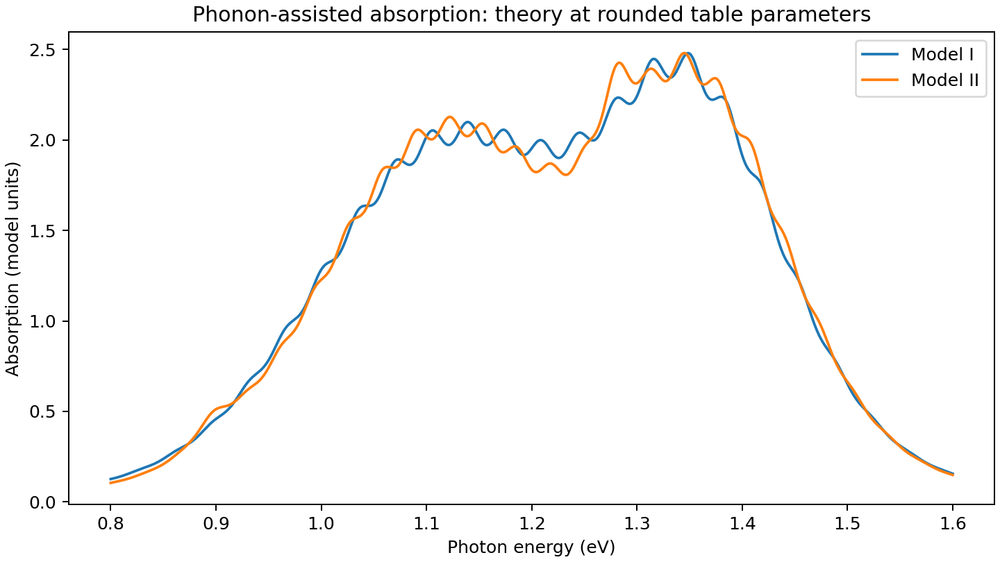

# Phonon-assisted absorption in TMD heterostructures

Computational models associated with Yifan Liu, Robert Dawson, Nathaniel
Gabor and Vivek Aji, **Phonon-assisted absorption in transition metal
dichalcogenide heterostructures**, Physical Review B **113**, 235306 (2026).
[DOI](https://doi.org/10.1103/v3sr-lg47) |
[arXiv:2602.02803](https://arxiv.org/abs/2602.02803).

This October 2026 release **reuses the pure forward functions from the
author's existing research scripts**, and adds an import-safe interface,
stable thermal weights, explicit units and numerical checks. It is not
presented as a recovered final production version or a complete reproduction
of every paper figure. No parameter fitting runs during import.

## Run

From the repository root, with Python 3.11:

```sh
python -m pip install -r requirements.txt
python -m unittest discover -s tests -v
python -m validation.run
python -m examples.theory_spectra
```

The example writes a PNG and CSV in `examples/output/`. Both contain
**theoretical curves at rounded table parameters**, not experimental data or
newly optimized fits. `validation/report.json` is a measured report that can
be regenerated without access to the original local research folder.

## Models and units

`phonon_absorption.model_i` implements the intraband-only single-mode polaron
spectrum. `model_ii` adds the coherent interband contributions and the three
weight factors from the paper. `spectrum` sums independent exciton channels
with shared phonon energy, linewidth and thermal energy.

```python
import numpy as np
from phonon_absorption import spectrum
from phonon_absorption.parameters import ANCHORS
energy = np.linspace(.85, 1.45, 512)
absorption = spectrum(energy, model="II", **ANCHORS["II"])
```

* Energies, phonon energies, linewidths, and `kBT_eV` are in **eV**.
  `kBT_eV` is thermal energy, not temperature in kelvin:
  `T_K = kBT_eV / 8.617333262145e-5`.
* `linewidth_eV` is the Lorentzian half width at half maximum. There is no
  `1/pi` normalization in the recovered spectral convention.
* `Channel.amplitude` is the multiplicative **squared** wavefunction factor.
  The source calls its square root `wf` and multiplies by `wf**2`.
  These fit amplitudes do not establish an absolute experimental unit.
* In Model I `coupling` is `g_cv=g_c-g_v`. In Model II it is
  `g_norm=sqrt(g_inter**2+g_diag**2)`, with
  `g_inter=g_norm*sin(theta)` and `g_diag=g_norm*cos(theta)`.
  The intraband limit is **theta=0, g_cv=2*g_norm**. Equal numeric couplings
  in the two models do not denote the same interaction.
* The public API accepts coupling magnitudes >=0, positive linewidth and
  phonon energy, and kBT>=0. Zero temperature uses the analytic Poisson
  limit. This does not imply a universally validated fitting domain.

The default sideband sum is **symmetric**, m=-80,...,+80, with no
renormalization of truncated weights. Increase `cutoff` to test convergence
at your parameters. The original references retain their asymmetric
`range(-50,50)` and `range(-20,20)` for source comparison.

## Numerical evidence

At the two rounded parameter anchors, the stable implementation agrees
with each recovered function to relative L2 error below 2e-15 when using
the identical historical truncation. On the 512-point .85-1.45 eV grid,
increasing the public cutoff from 80 to 120 makes no resolved difference
at these anchors. The Model II legacy cutoff differs from the expanded
sum by about 3.35e-5 in relative L2 norm. These observations do not prove
convergence throughout a fitting domain.

The thermal Bessel factor is a Skellam probability law with Poisson means
`S*(nB+1)` and `S*nB`, where `S=g_cv**2` (I) or `4*g_norm**2` (II).
This equivalent evaluation avoids multiplying a large exponential by a
small Bessel factor. The original Model I script produces nonfinite
values in an audited 1 meV thermal-energy case; the new evaluator is
finite and nonnegative in the included 0, 1 meV, 20 K and table-anchor
checks. Detailed balance, zero-coupling Lorentzians, zero-temperature
Poisson weights, and sixteen theta=0 limit cases are checked explicitly.
See the JSON report for the exact test scope.

## Data and provenance

No experimental spectrum points are distributed in this release. The old
fitting scripts contain 110 embedded points used for comparison with
published experiments. Their local bibliography points to Barati et al.,
*Vibronic Exciton-Phonon States in Stack-Engineered van der Waals
Heterojunction Photodiodes*, Nano Letters (2022),
[DOI:10.1021/acs.nanolett.2c00944](https://doi.org/10.1021/acs.nanolett.2c00944).
They are **not Yifan Liu's raw experimental measurements**. Point-level
digitization, intensity normalization, uncertainties and redistribution
terms were not established in the supplied materials.

The earlier local audit obtained MSE 0.00876532 (I) and 0.00694685 (II)
on those embedded points, without refitting. Model II did **not** recover
the paper's reported 0.0064. The discrepancy remains unresolved; this
release makes no claim of reproducing that fit statistic. The table
temperatures are effective fitting parameters, not independent sample
thermometry or proof of a local-heating mechanism.

[Provenance and version choices](docs/provenance.md) explains the exact
reused files and exclusions; [source fingerprints](docs/source_manifest.json)
identify the inputs. Cite the associated paper with `citation.bib` or
`CITATION.cff`.

## Generated example


