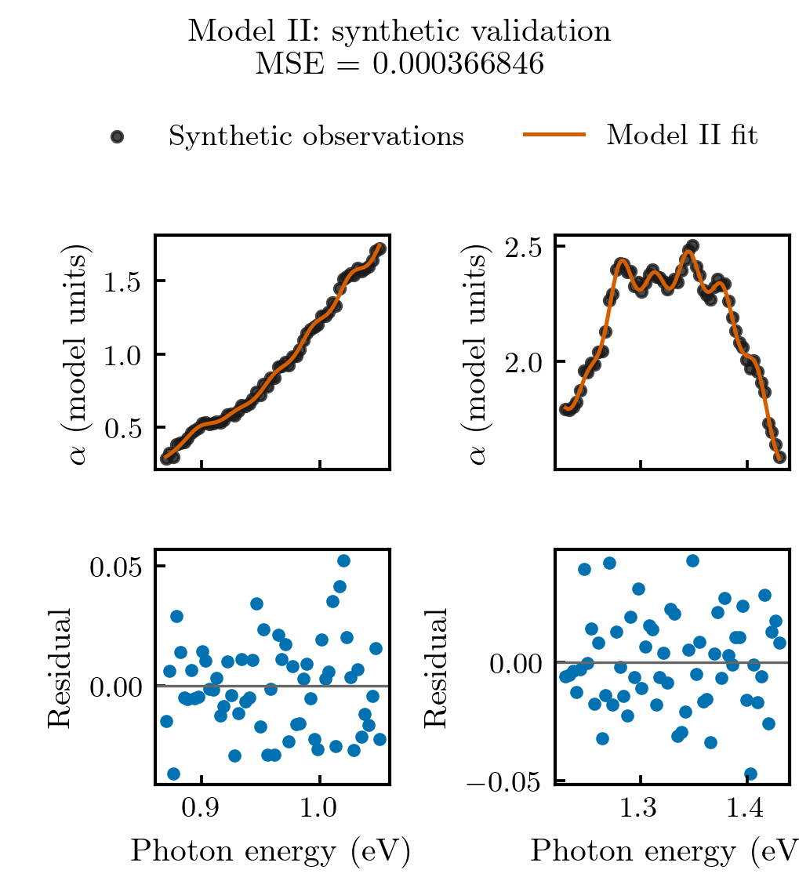
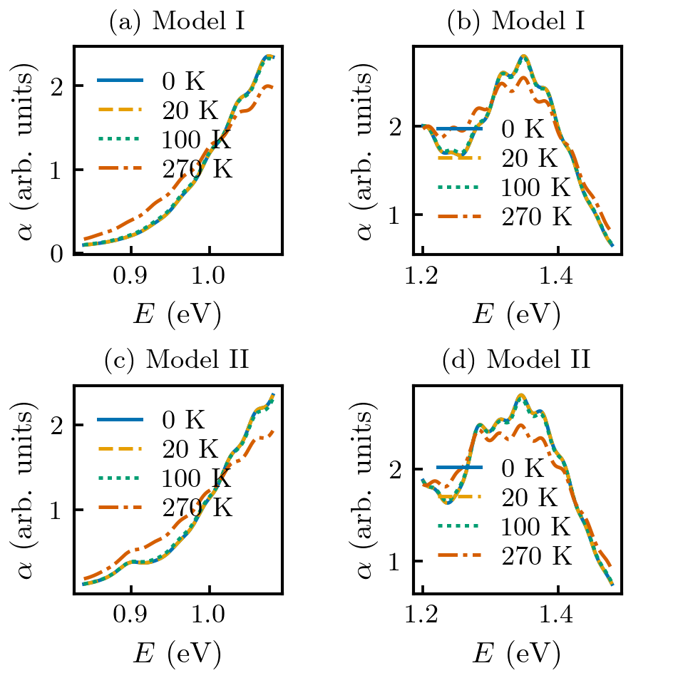

# Phonon-assisted absorption in TMD heterostructures

Computational models associated with Yifan Liu, Robert Dawson, Nathaniel
Gabor and Vivek Aji, **Phonon-assisted absorption in transition metal
dichalcogenide heterostructures**, Physical Review B **113**, 235306 (2026).
[DOI](https://doi.org/10.1103/v3sr-lg47) |
[arXiv:2602.02803](https://arxiv.org/abs/2602.02803).

Version 0.2 adds bounded multistart fitting, independent phonon energies and
linewidths per exciton, adaptive sideband sums, reusable spectral kernels,
and reproducible figures. The formulas come from the author's three
`Version_2_removing_middle` scripts. The original files remain unchanged;
no fitting or plotting runs during package import. This is a new numerical
implementation, not an assertion that a final historical production version
has been recovered.



The points above are **seeded synthetic data**, generated by this package.
Experimental comparison points from the research scripts are not distributed.

## Run

From the repository root, with Python 3.10 or later:

```sh
python -m pip install .
python -m phonon_absorption.cli demo
python -m unittest discover -s tests -v
python -m validation.run
```

The demo writes Model I/II synthetic data, fit reports, PNG/SVG fit and residual
plots, temperature-dependent spectra, and an exciton-channel decomposition to
`examples/output/`. Reproducible results are recorded in
[synthetic validation](validation/synthetic_validation.json). The existing
`python -m examples.theory_spectra` rounded-table example remains available.

To fit a local CSV with columns `energy_eV,absorption` and optional `sigma`:

```sh
python -m phonon_absorption.cli fit \
  --data examples/output/synthetic_observations_II.csv \
  --config configs/model_ii_shared.json \
  --output examples/output/my_fit
```

This produces `fit.json`, `fit_at_observations.csv`, `fit.png`, and `fit.svg`.
Nothing is uploaded by these commands. Configurations keep exciton energies
fixed, following the supplied scripts:

| Configuration in `configs/` | Model assumptions |
|---|---|
| `model_i_shared.json` | Model I, shared phonon energy and linewidth |
| `model_ii_shared.json` | Model II, shared phonon energy and linewidth |
| `model_ii_independent_frequencies.json` | Model II, two fitted phonon energies, shared linewidth |
| `model_ii_independent_fixed_modes.json` | Model II, fixed phonons 0.033/0.0295 eV, independent linewidths |

See [fitting and numerical details](docs/numerics.md) for named bounds,
uncertainties, truncation diagnostics, and performance measurements.

## Models and units

```python
import numpy as np
from phonon_absorption import spectrum
from phonon_absorption.parameters import ANCHORS

energy = np.linspace(.85, 1.45, 512)
absorption = spectrum(energy, model="II", cutoff=None, **ANCHORS["II"])
```

`model_i` implements the intraband single-mode polaron spectrum. `model_ii`
adds coherent interband terms. `spectrum` sums exciton channels with shared
phonon energy and linewidth; `VibronicChannel` and `spectrum_independent`
support separate values per exciton. These independent channels each have
one mode; this is not a multimode coupling calculation for one exciton.

* Energies, linewidths, and `kBT_eV` are in **eV**. Thermal energy is converted
  to kelvin with `T_K = kBT_eV / 8.617333262145e-5`.
* `linewidth_eV` is the Lorentzian half width at half maximum. The recovered
  spectral convention has no `1/pi` normalization.
* `Channel.amplitude` multiplies the spectrum as **squared** wavefunction
  amplitude. It corresponds to `wf**2` in the source, not `wf`.
* Model I coupling is `g_cv`. Model II coupling is `g_norm`, where
  `g_inter=g_norm*sin(theta)` and `g_diag=g_norm*cos(theta)`. The intraband
  limit is **theta=0, g_cv=2*g_norm**.
* Zero temperature uses Poisson weights, and zero coupling uses a delta
  weight. Positive phonon energy/linewidth and nonnegative thermal energy,
  coupling magnitude, and amplitude are required.

The compatible default is `cutoff=80`, summing m=-80,...,+80 without
renormalization. Use `cutoff=None` for adaptive support with explicit
omitted-tail diagnostics. `prepare_spectrum` reuses weights and centers
when parameters are fixed. Evaluation blocks limit estimated temporary
array sizes; they are not a guarantee on total process memory.

## Validation and figures

At the rounded anchors, identical historical cutoffs reproduce the extracted
Model I/II functions with relative L2 error below 2e-15. The independent
frequency/linewidth implementation is also checked against the extracted
third script. Physical-limit tests, 48 adaptive-versus-expanded-cutoff
probes, a low-temperature SciPy overflow regression, and synthetic fitting
checks are included. See [measured report](validation/report.json) for scope.

The synthetic fits have RMSE against generating theory of approximately
0.00548 (I) and 0.00694 (II), with input noise sigma 0.02. This checks spectrum
recovery in these examples, not uniqueness of fitted physical parameters.



[Model I fit](docs/synthetic_fit_I.png) ·
[Exciton-channel decomposition](docs/channel_decomposition.png) ·
[Original rounded-table spectra](docs/theory_spectra.png).
All new figures also have SVG versions in `docs/`.

## Data and provenance

The three source scripts contain the same 110 embedded comparison points.
Their local bibliography points to Barati et al., *Vibronic Exciton-Phonon
States in Stack-Engineered van der Waals Heterojunction Photodiodes*,
Nano Letters (2022),
[DOI:10.1021/acs.nanolett.2c00944](https://doi.org/10.1021/acs.nanolett.2c00944).
They are **not Yifan Liu's raw experimental measurements**. Exact
digitization, normalization, uncertainties, and redistribution terms were
not established. Point arrays and experimental overlays are kept outside
this public repository.

New local refits yield MSE 0.00816122 (I), 0.00550213 (II), and 0.00426700
(II with fixed independent phonons and independent linewidths).
[Aggregate fit report](validation/local_refit_summary.json) records the
assumptions and optimizer diagnostics, without distributing observations,
predictions, or residuals. Different fixed energies and mode assumptions
mean these MSEs alone are not formal model selection.

The earlier rounded-parameter audit gave MSE 0.00876532 (I) and 0.00694685
(II), without refitting. The latter did not reproduce the paper's 0.0064;
that historical discrepancy remains unresolved. A lower MSE from the new
optimizer does not recover the historical fit. Fitted temperatures are
effective parameters, not independent sample thermometry.

[Provenance](docs/provenance.md) and
[source fingerprints](docs/source_manifest.json) document the inputs.
Cite the associated paper using `citation.bib` or `CITATION.cff`.

## Figure exports

Figures now follow [publication template v0](docs/figure_style.md), with
LM Roman 10 text, Computer Modern mathematics, 10/9 pt typography and a
8.6 cm single-column or 17.8 cm double-column printed width. PDF, 300 dpi PNG, SVG and typography records accompany
the figures. The saved numerical data are unchanged.
